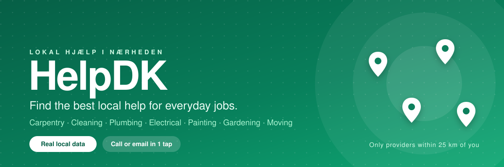
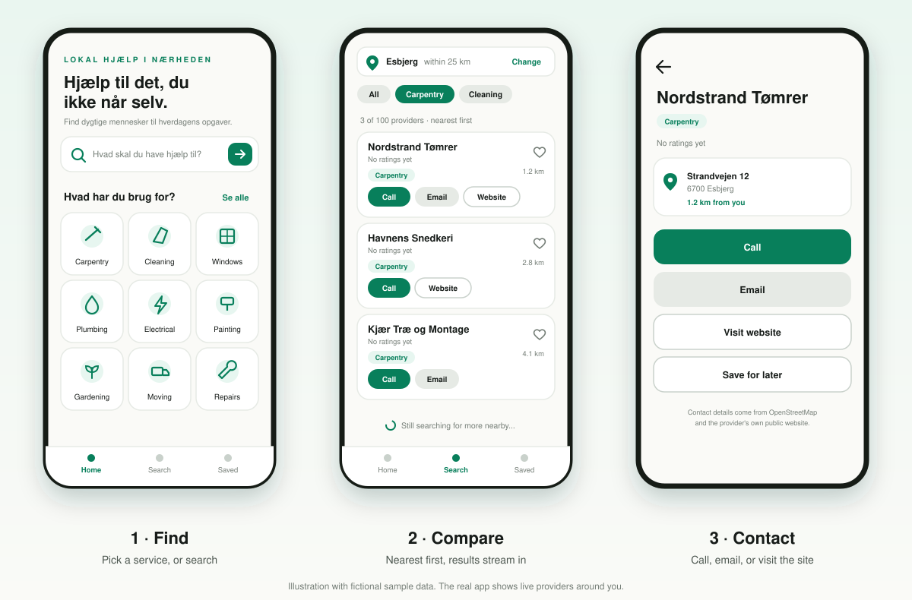
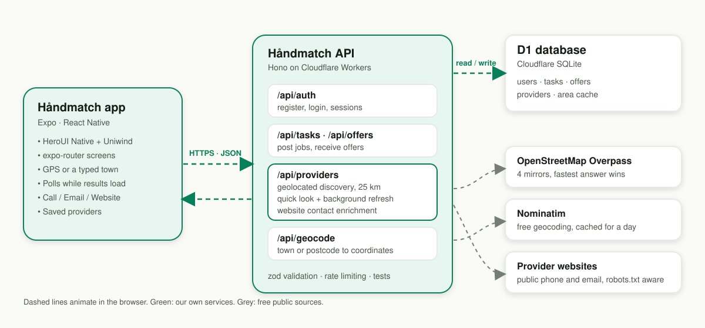
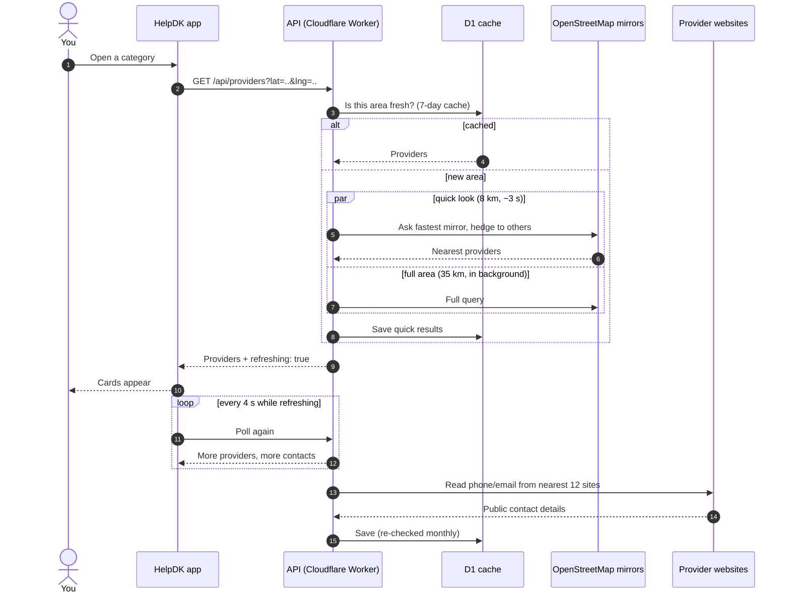

<div align="center">



<br />

**Find the right local help for everyday jobs, from real businesses near you.**
<br />
Carpentry, cleaning, plumbing, electrical, painting, gardening, moving and more.
Call or email them in one tap.

<br />

[](apps/mobile)
[](apps/mobile)
[](apps/api)
[](apps/api)
[](apps/api/tsconfig.json)
[](#-testing)
[](#-data-sources-and-fair-use)
[](#-contributing)

<br />

[**Demo**](#-demo) ·
[**Screens**](#-screens) ·
[**Features**](#-features) ·
[**How it works**](#-how-it-works) ·
[**Quick start**](#-quick-start) ·
[**API**](#-api-reference) ·
[**Roadmap**](#-roadmap)

</div>

---

<a id="-where-to-go"></a>

## 🧭 Where do you want to go?

| I want to... | Go here |
| --- | --- |
| **See it in action** | [Demo](#-demo) · [Screens](#-screens) |
| **Run it on my phone** | [Quick start](#-quick-start) |
| **Work on the app (front end)** | [`apps/mobile`](apps/mobile) · [its README](apps/mobile/README.md) · [design notes](apps/mobile/DESIGN.md) |
| **Work on the server (back end)** | [`apps/api`](apps/api) · [provider search](apps/api/src/providers/routes.ts) · [Overpass client](apps/api/src/sources/overpass.ts) |
| **Understand how providers are found** | [How it works](#-how-it-works) · [categories](apps/api/src/categories.ts) |
| **Call the API** | [API reference](#-api-reference) |
| **See what is planned** | [Roadmap](#-roadmap) |

---

<a id="-demo"></a>

## 🎬 Demo

A 16-second loop of the real flow: the first providers show up in about three seconds, more stream in while you browse, phone numbers and emails fill in from each provider's own site, then one tap to call.

<div align="center">
  
  <br />
  <sub>Animated illustration with fictional sample data. Open the page in a browser to see it move.</sub>
</div>

---

<a id="-screens"></a>

## 📱 Screens

<div align="center">
  
</div>

<details>
<summary><b>What each screen does</b></summary>

<br />

| Screen | What you can do | Code |
| --- | --- | --- |
| **Home** | Pick a service category or start a search. Danish-first copy, warm green identity. | [`(tabs)/index.tsx`](apps/mobile/src/app/(tabs)/index.tsx) |
| **Search / results** | See providers within 25 km, nearest first. Filter by category, search by name. New results appear on their own while the server keeps looking. | [`(tabs)/search.tsx`](apps/mobile/src/app/(tabs)/search.tsx) · [`provider-list.tsx`](apps/mobile/src/components/provider-list.tsx) |
| **Provider card** | Name, categories, distance, and **Call / Email / Website** buttons that only appear when a usable value exists. | [`provider-card.tsx`](apps/mobile/src/components/provider-card.tsx) · [`contact-actions.tsx`](apps/mobile/src/components/contact-actions.tsx) |
| **Provider detail** | Address, distance, full-size contact buttons, save for later. | [`provider/[id].tsx`](apps/mobile/src/app/provider/[id].tsx) |
| **Saved** | Providers you bookmarked. | [`(tabs)/saved.tsx`](apps/mobile/src/app/(tabs)/saved.tsx) |
| **Tasks and offers** | Customers post a job, providers send offers, customers accept one. | [`create-task.tsx`](apps/mobile/src/app/create-task.tsx) · [`task/[id].tsx`](apps/mobile/src/app/task/[id].tsx) |
| **Sign in / register** | Accounts with customer and provider roles. | [`login.tsx`](apps/mobile/src/app/login.tsx) · [`register.tsx`](apps/mobile/src/app/register.tsx) |

</details>

---

<a id="-features"></a>

## ✨ Features

<table>
<tr>
<td width="50%" valign="top">

### 📍 Truly local
Results come from a **25 km radius** around you (GPS, or a town you type). Esbjerg never shows you Copenhagen.

### ⚡ Fast first, complete later
You see the nearest providers in **about 3 seconds**. The rest of the area loads in the background and the list updates itself.

### 📞 Contact in one tap
**Call**, **Email** or open the **Website** straight from the card. Links are validated, so odd data never opens something strange.

</td>
<td width="50%" valign="top">

### 🔎 Real businesses, no sign-up wall
Providers are collected from open map data across **9 service categories**, not typed in by hand.

### 📬 Contact details filled in for you
Open map data rarely lists phone numbers or emails, so HelpDK reads them from each business's **own public website** (respecting `robots.txt`).

### 🧰 Tasks and offers
Post a job, receive offers from providers, and accept the one you like.

</td>
</tr>
</table>

<details>
<summary><b>The 9 service categories</b></summary>

<br />

`carpentry` · `cleaning` · `window-cleaning` · `plumbing` · `electrical` · `painting` · `gardening` · `moving` · `repairs`

Each category is recognised from OpenStreetMap tags, with Danish keyword fallbacks where the map has no good tag (for example *rengøring*, *vinduespolering*, *flytning*). See [`categories.ts`](apps/api/src/categories.ts).

</details>

---

<a id="-how-it-works"></a>

## 🧠 How it works

<div align="center">
  
</div>

### One search, step by step



<details>
<summary><b>Why it is fast on free infrastructure</b></summary>

<br />

OpenStreetMap's public servers are free but shared, so they can be slow or busy. HelpDK works around that without paying for anything:

- **Hedged mirrors.** The fastest mirror is asked first; if it has not answered within 4 seconds, the next one is asked too. The first good answer wins and the rest are cancelled. HTTP 200 answers that carry a runtime-error remark are never trusted.
- **Quick look, then the full area.** A small 8 km query answers first. The full 35 km refresh keeps running in the background (capped at 28 s to fit Cloudflare's background window).
- **D1 cache.** Areas are cached per ~11 km grid cell and category for 7 days. Providers that stop being confirmed for 14 days are hidden.
- **No stampedes.** Identical searches share one fetch, and a failing upstream is left alone for 60 seconds.
- **Polling, not waiting.** The server says `refreshing: true`; the app asks again every 4 seconds and the list grows.

</details>

<details>
<summary><b>How phone numbers and emails are found</b></summary>

<br />

1. Use the phone and email from OpenStreetMap when present.
2. Otherwise read the provider's homepage (and one same-site contact page) for `mailto:` and `tel:` links, then clearly labelled numbers in the text. Nothing is guessed; a bare run of digits is ignored.
3. Stay safe: only public `http(s)` sites, redirects are followed by hand and every hop is checked (no private or internal addresses), `robots.txt` is honoured, pages are size and time limited.
4. Store website-derived values separately so map refreshes never wipe them, and re-check each site at most monthly. A successful re-check replaces old values; a failed one keeps them and retries the next day.

Code: [`website-contacts.ts`](apps/api/src/sources/website-contacts.ts)

</details>

<details>
<summary><b>Tech stack</b></summary>

<br />

| Layer | Tools |
| --- | --- |
| Mobile | Expo SDK 58, React Native, expo-router, HeroUI Native, Uniwind (Tailwind-style utilities), lucide icons, expo-location |
| API | Hono, Zod validation, Cloudflare Workers, Wrangler |
| Data | Cloudflare D1 (SQLite), migrations in [`apps/api/migrations`](apps/api/migrations) |
| Sources | OpenStreetMap Overpass, Nominatim geocoding, providers' own websites |
| Quality | TypeScript, Vitest, ESLint |

</details>

---

<a id="-quick-start"></a>

## 🚀 Quick start

You need a current **Node.js** (LTS) and a phone with **Expo Go** (or an emulator). Everything runs locally and free.

### 1. Start the API

```bash
cd apps/api
npm install
npm run db:migrate:local      # creates the local database
npm run dev:lan               # serves on your network so a phone can reach it
```

The API listens on port `8787`.

### 2. Start the app

```bash
cd apps/mobile
npm install
cp .env.example .env          # then edit EXPO_PUBLIC_API_URL
npm start
```

Scan the QR code with Expo Go.

<details>
<summary><b>Which API address should I use?</b></summary>

<br />

Set `EXPO_PUBLIC_API_URL` in `apps/mobile/.env`:

| You run the app on | Use |
| --- | --- |
| **A physical phone** | `http://<your computer's LAN IP>:8787` and start the API with `npm run dev:lan` |
| Android emulator | `http://10.0.2.2:8787` |
| iOS simulator or web | `http://localhost:8787` |
| A deployed Worker | its `https://...workers.dev` URL |

On Windows, allow the API through the firewall if asked.

</details>

<details>
<summary><b>Something is not working</b></summary>

<br />

- **Phone cannot log in or load anything:** the URL must be your computer's LAN IP, not `localhost`, and the API must be started with `npm run dev:lan`.
- **"table providers has no column..." errors:** run `npm run db:migrate:local` again in `apps/api`.
- **Port 8787 is busy / a second server keeps starting on 8788:** an old Wrangler process is still running. Stop it (on Windows, Git Bash: `taskkill //F //IM workerd.exe`) and start again.
- **Nothing shows up in a brand new area:** the first search there is slower once while the area is fetched; later ones are cached.
- **After pulling changes:** re-run `npm install` in `apps/mobile` (not the repo root) and apply new migrations with `npm run db:migrate:local`.

</details>

<details>
<summary><b>Useful commands</b></summary>

<br />

| Where | Command | What it does |
| --- | --- | --- |
| `apps/api` | `npm run dev` / `npm run dev:lan` | Start the API (local only / reachable from your phone) |
| `apps/api` | `npm test` | Run API tests |
| `apps/api` | `npm run typecheck` | Type-check the API |
| `apps/api` | `npm run db:migrate:local` / `db:migrate:remote` | Apply migrations locally / to the deployed database |
| `apps/api` | `npm run deploy` | Deploy to Cloudflare Workers |
| `apps/mobile` | `npm start` | Start Expo |
| `apps/mobile` | `npm run android` / `ios` / `web` | Open on a platform |
| `apps/mobile` | `npm run lint` · `npm test` | Lint and test the app |

</details>

---

<a id="-api-reference"></a>

## 🔌 API reference

Base URL: `http://localhost:8787` in development. Source: [`apps/api/src`](apps/api/src).

| Method | Path | Who | Purpose |
| --- | --- | --- | --- |
| `GET` | `/api/providers` | anyone | Providers near a point |
| `GET` | `/api/providers/:id` | anyone | One provider |
| `GET` | `/api/geocode?q=` | anyone | Town or postcode to coordinates |
| `POST` | `/api/auth/register` · `/login` · `/logout` | anyone / signed in | Accounts |
| `GET` | `/api/auth/me` | signed in | Current user |
| `GET` `POST` | `/api/tasks` | customer posts | List and create tasks |
| `GET` `PATCH` `DELETE` | `/api/tasks/:id` | customer | Read, edit, remove a task |
| `GET` `POST` | `/api/tasks/:id/offers` | customer reads, provider sends | Offers on a task |
| `PATCH` `DELETE` | `/api/offers/:id` | provider | Change or withdraw an offer |
| `POST` | `/api/offers/:id/accept` | customer | Accept an offer |

<details>
<summary><b>Try the provider search</b></summary>

<br />

```bash
curl "http://localhost:8787/api/providers?lat=55.4765&lng=8.4594&category=plumbing&limit=5"
```

| Query | Default | Notes |
| --- | --- | --- |
| `lat`, `lng` | required | Where to search around |
| `radius` | `25` | Kilometres, max `25` |
| `category` | all | One of the 9 category ids |
| `q` | none | Name contains |
| `limit` | `100` | 1 to 100 |

Response shape:

```jsonc
{
  "providers": [
    {
      "id": "osm_n123456",
      "name": "Example VVS",
      "categories": ["plumbing"],
      "city": "Esbjerg",
      "phone": "+4575123456",
      "email": "info@example.dk",
      "website": "https://example.dk",
      "distanceKm": 1.2,
      "ratings": []
    }
  ],
  "radiusKm": 25,
  "stale": false,      // true: could not refresh, served saved data
  "refreshing": true   // true: still searching, ask again in a few seconds
}
```

</details>

---

<a id="-testing"></a>

## ✅ Testing

```bash
cd apps/api    && npm run typecheck && npm test      # geo, categories, hedged mirrors, contact extraction
cd apps/mobile && npm run lint && npm test           # contact link builders and more
```

The tests cover the parts that are easy to get subtly wrong: the hedged mirror race, runtime-error answers, redirect and private-address safety, phone and email extraction, and the link builders behind the buttons.

---

<a id="-data-sources-and-fair-use"></a>

## 🌍 Data sources and fair use

- **Provider data** is © [OpenStreetMap contributors](https://www.openstreetmap.org/copyright), available under the [ODbL](https://opendatacommons.org/licenses/odbl/). OpenStreetMap does not include ratings or prices, so cards say "No ratings yet".
- **Geocoding** uses [Nominatim](https://operations.osmfoundation.org/policies/nominatim/) with an identifying User-Agent and a day of caching, as its usage policy asks.
- **Provider websites** are read only for public contact details, while honouring `robots.txt`, with strict size and time limits and a monthly re-check.
- The public Overpass servers are shared community infrastructure: HelpDK caches heavily to be a good citizen. For heavy production use, plan on a self-hosted instance or a paid source (see the roadmap).

---

<a id="-roadmap"></a>

## 🗺️ Roadmap

Ideas, in no particular order. Nothing here is promised.

- [ ] Ratings and reviews from another source (for example Google Places), shown beside the map data
- [ ] Durable background work with a Cloudflare Queue, instead of `waitUntil`
- [ ] Self-hosted Overpass or a paid data source for production reliability
- [ ] Price hints and "cheapest" sorting once price data exists
- [ ] Saved providers synced to the account instead of kept on the device
- [ ] More service categories and English keyword rules
- [ ] Real screenshots and a screen recording in this README

---

<a id="-project-structure"></a>

## 🗂️ Project structure

<details>
<summary><b>Open the map of the repo</b></summary>

<br />

```text
HandyService/
├── apps/
│   ├── mobile/                  Expo / React Native app
│   │   └── src/
│   │       ├── app/             screens (expo-router): tabs, provider, task, auth
│   │       ├── components/      provider card/list, contact actions, UI primitives
│   │       ├── hooks/           use-providers (progressive loading), location, saved
│   │       └── lib/             api client, contact link builders, geo helpers
│   └── api/                     Hono API on Cloudflare Workers
│       ├── migrations/          D1 schema (auth, tasks, providers, contacts)
│       ├── src/
│       │   ├── auth/            register, login, sessions, rate limits
│       │   ├── tasks/           tasks and offers
│       │   ├── providers/       search route + D1 queries
│       │   └── sources/         overpass.ts, website-contacts.ts
│       └── tests/               Vitest suites
└── docs/images/                 the diagrams and illustrations in this README
```

</details>

---

<a id="-contributing"></a>

## 🤝 Contributing

1. Branch from `main` (`feat/...`, `fix/...`, `docs/...`).
2. Keep `npm run typecheck`, `npm test` and `npm run lint` green.
3. Open a pull request and comment `@codex review`; address the findings before merging.

<details>
<summary><b>Adding real screenshots or a screen recording</b></summary>

<br />

The images above are vector illustrations with sample data. To add real captures, drop PNGs, a GIF or an MP4 into [`docs/images`](docs/images) and reference them from this README. GitHub plays an `.mp4` pasted straight into the README editor.

</details>

---

<div align="center">

Made with care for people who just need a hand with the house. 🏡

<sub>The mobile app started from the Expo template (MIT, see [`apps/mobile/LICENSE`](apps/mobile/LICENSE)).</sub>

<br />

[⬆ Back to top](#)

</div>
